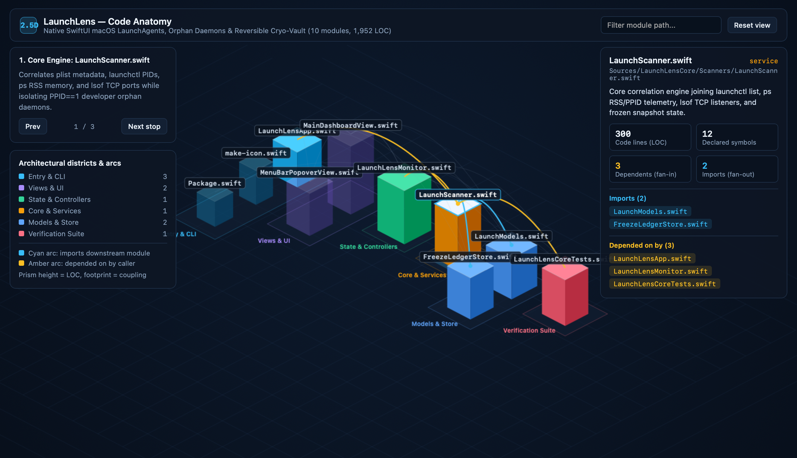

# code-anatomy

**Agent Skill & zero-dependency compiler that turns any local codebase into an offline, self-contained 2.5D Isometric HTML5 Canvas architecture map.**



When onboarding onto an unfamiliar repository or auditing a large multi-agent PR, flat file trees and static Mermaid boxes hide **scale, coupling, and architectural gravity**.

**code-anatomy** (`SKILL.md` + `scripts/build_anatomy.py`) scans Python, Swift, TypeScript/JavaScript, Go, Rust, and C/C++ repositories in under two seconds—using only the Python 3.10+ standard library—and compiles a `<50 KB` interactive **2.5D Isometric Architecture Map** (`architecture-anatomy.html`) with **zero external CDNs, zero cloud uploads, and zero leaked host paths**.

## What It Maps

- **2.5D Extruded Module Prisms** — Organized into isometric architectural districts (`Entry & CLI`, `Views & UI`, `State & Controllers`, `Core & Services`, `Models & Store`, `Verification Suite`). Prism height encodes **LOC**; footprint encodes **coupling (`fan-in` + `fan-out`)**.
- **Overhead Dependency Arcs** — Click or hover any module to illuminate outgoing imports (**cyan arcs**) and incoming dependents (**amber arcs**).
- **Guided Architecture Tour** — Automatically selects the primary entrypoint, highest-gravity shared hub, and largest implementation engine—or accepts an agent-authored `--annotations annotations.json` walkthrough.
- **Polyglot Static Resolution** — Python `ast` relative/package imports, Swift intra-module PascalCase type references + target imports, TypeScript/JS relative ES/CommonJS imports, Go, Rust, and C/C++.

## Install

### As an Agent Skill (Claude Code, Codex, OpenCode, Antigravity)

```bash
git clone https://github.com/zxu756/code-anatomy.git ~/.agents/skills/code-anatomy
```

Once installed, ask your agent:
- *"Use `code-anatomy` to generate an interactive 2.5D architecture map of this repository."*
- *"给当前项目生成一份离线可交互的 2.5D 代码架构全景图，并标出核心依赖枢纽。"*

### Standalone CLI

```bash
python3 scripts/build_anatomy.py /path/to/repo \
  --out docs/architecture-anatomy.html \
  --exclude-tests
```

## Optional Semantic Annotations (`--annotations`)

Agents can enrich module descriptions and tour stops by passing `--annotations annotations.json` (see [references/schema.md](references/schema.md)).

## Specification & Tests

```bash
python3 -m unittest discover -s tests -v
```

Full engineering spec: [docs/SPEC.md](docs/SPEC.md).

## License

MIT
